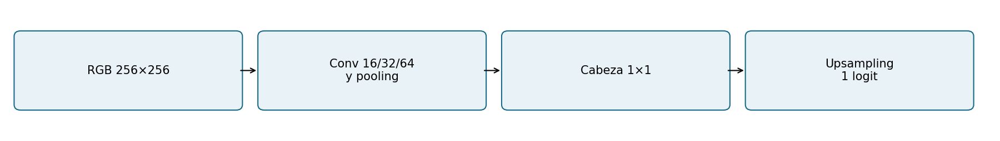
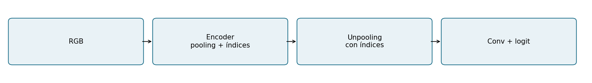
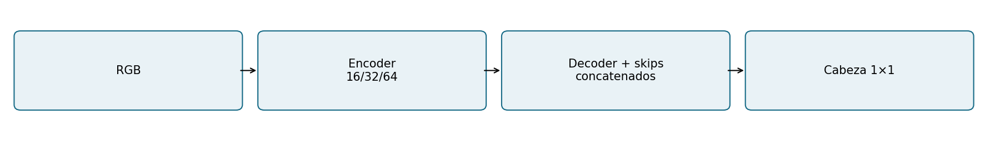
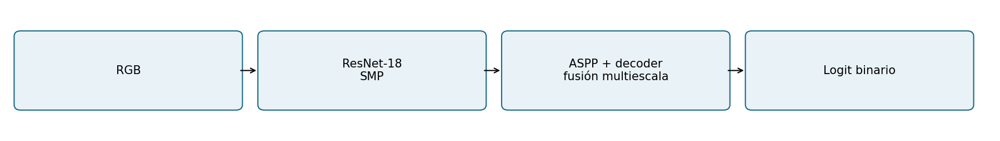
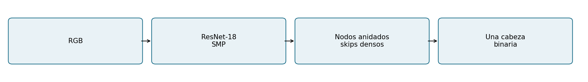
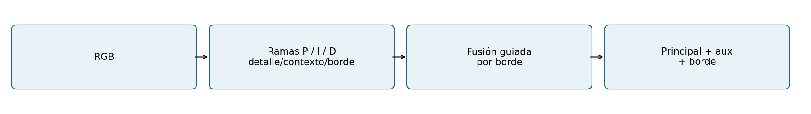
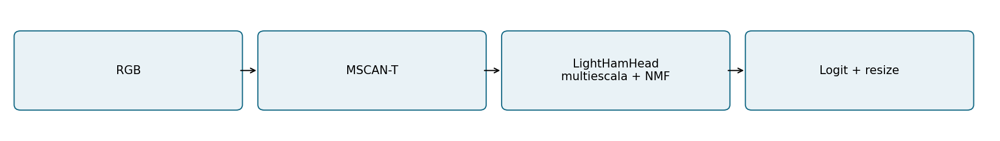
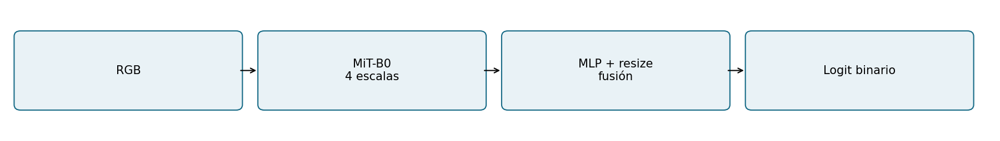
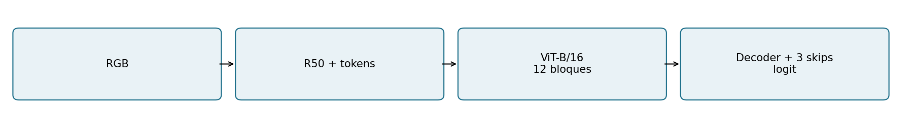
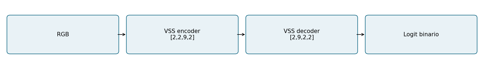

# Fichas de las diez implementaciones

Las fichas describen el código ejecutado. Cada diagrama es un esquema de mecanismos, no un volcado completo de capas. Las dimensiones exactas se consultan en el código y la configuración fijada. Las referencias arXiv conservan el año del preprint; no se confunde con el año de publicación editorial.
Las cifras de este benchmark proceden de los artefactos auditados. Las tablas numéricas originales de los artículos, FLOPs adaptados y tiempos de los papers no están certificados por estas fichas; su cotejo continúa pendiente en el checklist. No se inventan cuartiles de conferencias.

## FCN compacta

**Familia:** CNN. **Parámetros medidos:** 72,145.
**Fuente primaria:** Long, Jonathan; Shelhamer, Evan; Darrell, Trevor (2014). *Fully Convolutional Networks for Semantic Segmentation*. [DOI del preprint](https://doi.org/10.48550/arXiv.1411.4038); [texto y versiones](https://arxiv.org/abs/1411.4038).

Implementación compacta local; no FCN-8s original, sin sus fusiones laterales. Dos reducciones espaciales.

$h_j=\mathrm{ReLU}(b_j+\sum_i W_{ji}*x_i)$; la interpolación devuelve la salida al lienzo.

Costo convolucional O(HW k² Ci Co). Bajo tamaño; el mapa grueso puede perder detalle. Artículo fundacional excluido de la ventana reciente con justificación.

**Receta:** Adam, lr=0.001, weight decay=0.0; cinco semillas; mismo tamaño, criterio de parada y salida de un logit.
**Resultado local:** Dice test 0.8535 ± 0.0136; no sustituye el resultado del artículo original.

## SegNet compacta

**Familia:** CNN. **Parámetros medidos:** 85,761.
**Fuente primaria:** Badrinarayanan, Vijay; Kendall, Alex; Cipolla, Roberto (2015). *SegNet: A Deep Convolutional Encoder-Decoder Architecture for Image Segmentation*. [DOI del preprint](https://doi.org/10.48550/arXiv.1511.00561); [texto y versiones](https://arxiv.org/abs/1511.00561).

Compacta local 16/32/64; no encoder VGG16 completo del artículo.

$u=\mathrm{Unpool}(z,\operatorname{argmaxpool}(h))$ reutiliza posiciones, no todos los valores del encoder.

Convoluciones más almacenamiento de índices; ahorra mapas de skip pero no certifica menor latencia sin medición.

**Receta:** Adam, lr=0.001, weight decay=0.0; cinco semillas; mismo tamaño, criterio de parada y salida de un logit.
**Resultado local:** Dice test 0.8247 ± 0.0334; no sustituye el resultado del artículo original.

## U-Net compacta

**Familia:** CNN. **Parámetros medidos:** 118,273.
**Fuente primaria:** Ronneberger, Olaf; Fischer, Philipp; Brox, Thomas (2015). *U-Net: Convolutional Networks for Biomedical Image Segmentation*. [DOI del preprint](https://doi.org/10.48550/arXiv.1505.04597); [texto y versiones](https://arxiv.org/abs/1505.04597).

U-Net compacta local; encoder propio, no ResNet-18. Dos niveles de reducción.

$d_l=\mathrm{Conv}([e_l,\mathrm{Up}(d_{l+1})])$ preserva detalle por concatenación.

Convoluciones y activaciones de skip; fundamento médico, adaptación binaria HAZMAT sin preentrenamiento.

**Receta:** Adam, lr=0.001, weight decay=0.0; cinco semillas; mismo tamaño, criterio de parada y salida de un logit.
**Resultado local:** Dice test 0.8464 ± 0.0137; no sustituye el resultado del artículo original.

## DeepLabv3+ R18

**Familia:** CNN. **Parámetros medidos:** 12,329,297.
**Fuente primaria:** Chen, Liang-Chieh; Zhu, Yukun; Papandreou, George; Schroff, Florian; Adam, Hartwig (2018). *Encoder-Decoder with Atrous Separable Convolution for Semantic Image Segmentation*. [DOI del preprint](https://doi.org/10.48550/arXiv.1802.02611); [texto y versiones](https://arxiv.org/abs/1802.02611).

SMP 0.5.0, ResNet-18; no Xception de los resultados principales del paper.

$(x*_r w)(i)=\sum_k x(i+r k)w(k)$; ASPP combina distintas dilataciones.

Contexto multiescala y refinamiento. Cambian backbone, clases y receta; sus cifras originales no son una referencia numérica directamente comparable.

**Receta:** AdamW, lr=0.0005, weight decay=0.01; cinco semillas; mismo tamaño, criterio de parada y salida de un logit.
**Resultado local:** Dice test 0.8140 ± 0.0246; no sustituye el resultado del artículo original.

## U-Net++ R18

**Familia:** CNN. **Parámetros medidos:** 15,970,449.
**Fuente primaria:** Zhou, Zongwei; Siddiquee, Md Mahfuzur Rahman; Tajbakhsh, Nima; Liang, Jianming (2019). *UNet++: Redesigning Skip Connections to Exploit Multiscale Features in Image Segmentation*. [DOI del preprint](https://doi.org/10.48550/arXiv.1912.05074); [texto y versiones](https://arxiv.org/abs/1912.05074).

SMP sin supervisión profunda ni poda. Su encoder y tamaño difieren de la U-Net compacta.

$x^{i,j}=H([x^{i,0},\ldots,x^{i,j-1},U(x^{i+1,j-1})])$ representa la fusión anidada.

Más conexiones y memoria de activaciones. Comparar estas redes no aísla el efecto de los skips.

**Receta:** Adam, lr=0.0005, weight decay=0.0; cinco semillas; mismo tamaño, criterio de parada y salida de un logit.
**Resultado local:** Dice test 0.8076 ± 0.0059; no sustituye el resultado del artículo original.

## PIDNet-S

**Familia:** CNN. **Parámetros medidos:** 7,716,291.
**Fuente primaria:** Xu, Jiacong; Xiong, Zixiang; Bhattacharyya, Shankar P. (2022). *PIDNet: A Real-time Semantic Segmentation Network Inspired by PID Controllers*. [DOI del preprint](https://doi.org/10.48550/arXiv.2206.02066); [texto y versiones](https://arxiv.org/abs/2206.02066).

Código de autores; m=2, n=3, planes=32, ppm=96, head=128. Tres salidas conservadas.

$L=L_{principal}+0,4L_{aux}+1,0L_{borde}$ en nuestra receta; el objetivo de borde deriva de la máscara.

La analogía PID es estructural; no es un controlador físico. Las pérdidas auxiliares impiden atribuir toda diferencia solo a la topología.

**Receta:** AdamW, lr=0.001, weight decay=0.01; cinco semillas; mismo tamaño, criterio de parada y salida de un logit.
**Resultado local:** Dice test 0.7936 ± 0.0231; no sustituye el resultado del artículo original.

## SegNeXt-T

**Familia:** CNN con atención convolucional. **Parámetros medidos:** 4,225,121.
**Fuente primaria:** Guo, Meng-Hao; Lu, Cheng-Ze; Hou, Qibin; Liu, Zhengning; Cheng, Ming-Ming; Hu, Shi-Min (2022). *SegNeXt: Rethinking Convolutional Attention Design for Semantic Segmentation*. [DOI del preprint](https://doi.org/10.48550/arXiv.2209.08575); [texto y versiones](https://arxiv.org/abs/2209.08575).

Fuentes de autores con capa de compatibilidad local; SyncBN adaptada a ejecución monodispositivo. No es un Transformer.

$\mathrm{Att}(F)=F\odot \mathrm{Conv}_{1\times1}(\sum_i \mathrm{Branch}_i(\mathrm{DWConv}(F)))$ resume la atención convolucional.

Filtros separables multiescala; NMF de la cabeza puede usar inicialización aleatoria, por lo que se fija RNG de evaluación.

**Receta:** AdamW, lr=0.0001, weight decay=0.01; cinco semillas; mismo tamaño, criterio de parada y salida de un logit.
**Resultado local:** Dice test 0.7792 ± 0.0104; no sustituye el resultado del artículo original.

## SegFormer-B0

**Familia:** Transformer. **Parámetros medidos:** 3,714,401.
**Fuente primaria:** Xie, Enze; Wang, Wenhai; Yu, Zhiding; Anandkumar, Anima; Alvarez, Jose M.; Luo, Ping (2021). *SegFormer: Simple and Efficient Design for Semantic Segmentation with Transformers*. [DOI del preprint](https://doi.org/10.48550/arXiv.2105.15203); [texto y versiones](https://arxiv.org/abs/2105.15203).

SMP 0.5.0; encoder mit_b0, sin pesos externos. Paper guía; réplica original pendiente.

$\mathrm{Attention}(Q,K,V)=\mathrm{softmax}(QK^\top/\sqrt d)V$; reducción espacial de K,V disminuye costo.

Atención densa O(N²d), reducida según el factor espacial de cada etapa. No afirmar costo cuadrático idéntico al ViT estándar.

**Receta:** AdamW, lr=6e-05, weight decay=0.01; cinco semillas; mismo tamaño, criterio de parada y salida de un logit.
**Resultado local:** Dice test 0.7053 ± 0.0104; no sustituye el resultado del artículo original.

## TransUNet

**Familia:** Híbrido CNN–Transformer. **Parámetros medidos:** 105,322,001.
**Fuente primaria:** Chen, Jieneng; Lu, Yongyi; Yu, Qihang; Luo, Xiangde; Adeli, Ehsan; Wang, Yan; Lu, Le; Yuille, Alan L.; Zhou, Yuyin (2021). *TransUNet: Transformers Make Strong Encoders for Medical Image Segmentation*. [DOI del preprint](https://doi.org/10.48550/arXiv.2102.04306); [texto y versiones](https://arxiv.org/abs/2102.04306).

Código de autores; variante R50-ViT-B/16, tamaño 256, grid 16×16, n_skip=3. Sin carga de pesos.

$z_{l+1}=z_l+\mathrm{MSA}(\mathrm{LN}(z_l))$ seguido de bloque MLP residual; decoder recupera resolución.

Atención de tokens y CNN; gran capacidad y costo. Su liderazgo de media no prueba que la atención cause la mejora.

**Receta:** SGD, lr=0.001, weight decay=0.0001; cinco semillas; mismo tamaño, criterio de parada y salida de un logit.
**Resultado local:** Dice test 0.8626 ± 0.0057; no sustituye el resultado del artículo original.

## VM-UNet

**Familia:** SSM visual. **Parámetros medidos:** 44,273,833.
**Fuente primaria:** Ruan, Jiacheng; Li, Jincheng; Xiang, Suncheng (2024). *VM-UNet: Vision Mamba UNet for Medical Image Segmentation*. [DOI del preprint](https://doi.org/10.48550/arXiv.2402.02491); [texto y versiones](https://arxiv.org/abs/2402.02491).

VSSM de autores, drop_path=0,2; selective_scan CUDA real. No sustitución por GRU.

$h_t=\bar A_t h_{t-1}+\bar B_t x_t,\quad y_t=C_t h_t$ resume el mecanismo selectivo; escaneos visuales relacionan posiciones.

Costo lineal en longitud para dimensiones fijas del estado. Requiere extensiones CUDA; no extrapolar eficiencia teórica a latencia no medida.

**Receta:** AdamW, lr=0.001, weight decay=0.01; cinco semillas; mismo tamaño, criterio de parada y salida de un logit.
**Resultado local:** Dice test 0.8391 ± 0.0297; no sustituye el resultado del artículo original.
